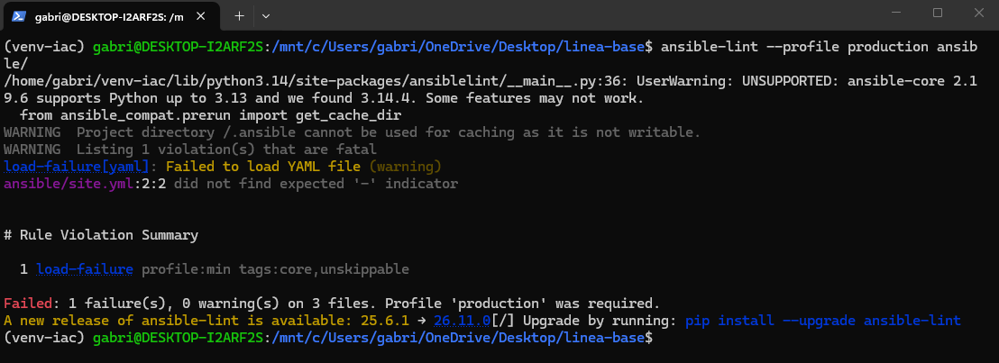
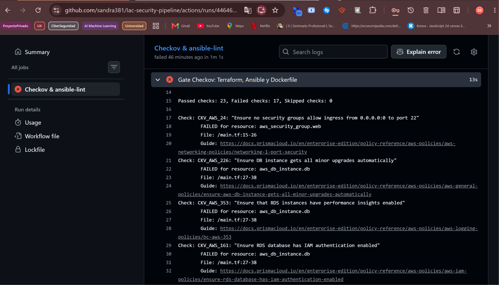

# Tarea: Análisis de seguridad IaC en el pipeline

**Curso:** Ciberseguridad  
**Universidad Galileo, FISICC**  
**Postgrado en Diseño y Desarrollo de Software**

## Integrantes

| Nombre | Carné | Usuario GitHub |
|---|---|---|
| Gabriela Lucía Navarro de León | 20000127 | Gabriela-Navarro |
| Sandra Daniela Soria Palma | 20002619 | sandra381 |

**Repositorio:** https://github.com/sandra381/Iac-security-pipeline


## 1. Línea base

Antes de crear el pipeline, se realizó un análisis local sobre la versión insegura del proyecto (commit `31e45b09`, "Versión insegura de práctica"). El análisis se hizo sobre los archivos de demo indicados en la guía de la tarea, copiados en `infra/`, `docker/` y `ansible/`. Estos archivos contienen configuraciones inseguras a propósito para que las herramientas puedan detectarlas.

Para esto se utilizaron Checkov 3.4.5 y ansible-lint 25.6.1.

```bash
checkov -d . --compact
ansible-lint --profile production ansible/
```

### Conteo de fallas por tipo de archivo

| Tipo de archivo | Herramienta | Pasaron | Fallaron |
|---|---|---|---|
| Terraform (`infra/main.tf`) | Checkov | 15 | 24 |
| Dockerfile (`docker/Dockerfile`) | Checkov | 25 | 5 |
| Secretos | Checkov | 0 | 1 |
| Ansible (`ansible/site.yml`) | ansible-lint | No se pudo analizar (error de indentación) | 1 |
| **Total** | | | **31** |


En el caso de Ansible, se encontró el error `load-failure[yaml]`. Esto sucedió porque el archivo `site.yml` tenía problemas de indentación y ansible-lint no podía leerlo correctamente.

Al revisar el archivo manualmente, también se encontraron otras configuraciones inseguras, como conexiones que no verificaban los certificados de seguridad, el uso de `shell` para ejecutar instrucciones en el servidor y archivos con permisos `0777`, que permiten a cualquier usuario del sistema leerlos, modificarlos y ejecutarlos.



### Los 5 hallazgos más graves y sus riesgos

Como Checkov en su versión gratuita no muestra la severidad, ordenamos los hallazgos según lo que consideramos más peligroso. Primero colocamos los recursos expuestos directamente a internet, luego las credenciales que podrían quedar expuestas y por último los datos que no cuentan con protección.

1. **CKV_AWS_24 – Acceso SSH abierto:** El servidor permite conexiones SSH desde cualquier dirección IP, por lo que cualquier persona en internet podría intentar acceder sin autorización.

2. **CKV_AWS_17 – Base de datos pública:** La base de datos está configurada para ser accesible desde internet, lo que aumenta el riesgo de ataques y exposición de información.

3. **CKV_SECRET_6 – Contraseña en el código:** Se encontró una contraseña escrita directamente en el código. Esto representa un riesgo porque cualquier persona con acceso al repositorio podría verla y utilizarla.

4. **CKV_AWS_16 – Base de datos sin cifrado:** La base de datos no tiene habilitado el cifrado, por lo que, si alguien obtiene una copia de los datos sin cifrar, podría leer la información.

5. **CKV_AWS_53 al 56 – Bucket S3 sin bloqueo público:** El bucket no tiene configuradas todas las restricciones de acceso público, por lo que los archivos almacenados podrían quedar expuestos a personas no autorizadas.

## 2. Diseño del pipeline

El pipeline se encuentra en el archivo `.github/workflows/iac-security.yml` y se encarga de revisar automáticamente los archivos de infraestructura para encontrar posibles problemas de seguridad. Si encuentra algún problema, el pipeline falla y, con la protección de la rama activada, no permite agregar esos cambios a `main`.

### 2.1 ¿Qué se escanea?

Se revisan los archivos de Terraform, Ansible y Dockerfile para detectar configuraciones que puedan representar un riesgo de seguridad. Además, se buscan contraseñas escritas directamente en el código y se comprueba que se cumpla con una política de seguridad creada por el equipo.

| Qué se revisa | Carpeta | Herramienta |
|---|---|---|
| Terraform | `infra/` | Checkov |
| Ansible | `ansible/` | Checkov y ansible-lint |
| Dockerfile | `docker/` | Checkov |
| Contraseñas o secretos en el código | Carpetas analizadas | Checkov |
| Política propia del equipo (regla en `politicas/`) | Se aplica sobre `infra/` | Checkov |

### 2.2 ¿En qué momento se ejecuta?

El pipeline se ejecuta automáticamente en dos casos:

- Cuando se crea o actualiza un **pull request** hacia la rama `main`.
- Cuando se realiza un **push** a la rama `main`.

```yaml
on:
  pull_request:
    branches: [ "main" ]
  push:
    branches: [ "main" ]
```

### 2.3 ¿Qué bloquea?

El pipeline cuenta con dos tipos de pasos, los que bloquean los cambios cuando encuentran problemas de seguridad y los que únicamente muestran los resultados.

**Pasos que bloquean (gates):** Se utilizan Checkov y ansible-lint para revisar los archivos. Si alguna de estas herramientas encuentra un problema de seguridad, el pipeline falla y no permite hacer el merge del pull request con la rama `main`, siempre que esta tenga activada la protección.

**Pasos que solo informan:** Se generan dos reportes SARIF, uno de Checkov y otro de ansible-lint, que se publican en la sección Security de GitHub. Estos reportes permiten revisar los problemas encontrados, incluso cuando los gates fallan. Ninguno de estos reportes bloquea los cambios.

### 2.4 Versiones fijas

```bash
pip install checkov==3.4.5 ansible-core==2.19.6 ansible-lint==25.6.1
```

Se utilizaron versiones fijas para que siempre se trabaje con las mismas versiones y evitar que una actualización cambie las reglas de seguridad o los resultados de las pruebas.

## 3. Evidencia del gate

Para comprobar que el pipeline bloquea los cambios inseguros, se creó un pull request donde se modificó intencionalmente una configuración de seguridad. En el commit `f8ca3e42` se cambió la configuración SSH para permitir conexiones desde cualquier dirección IP.

**Pull request:** [#1 Prueba: abro el puerto 22 (debe fallar)](https://github.com/sandra381/Iac-security-pipeline/pull/1)

### 3.1 El job falla

Al crear el pull request, el pipeline se ejecutó automáticamente y la revisión de seguridad de Checkov falló. Se encontraron 17 fallas, entre ellas `CKV_AWS_24`, que indica que el puerto 22 permite conexiones desde cualquier dirección IP, lo que representa un riesgo de seguridad.



### 3.2 La protección de rama impide el merge

La rama `main` tiene configurada una regla de protección que exige realizar los cambios mediante un pull request y que la revisión **Checkov & ansible-lint** termine correctamente antes de hacer el merge.

En el pull request, este check aparece marcado como **Required**, es decir, obligatorio. Como el check falló, GitHub desactivó el botón **Merge pull request** y no permite incorporar el cambio a `main`.


También se comprobó el funcionamiento de esta protección al intentar realizar un push directamente a `main` desde la computadora de una integrante del equipo. GitHub rechazó el cambio porque no cumplía con las reglas configuradas.

~~~
remote: error: GH013: Repository rule violations found for refs/heads/main.
remote: - Changes must be made through a pull request.
remote: - Required status check "Checkov & ansible-lint" is expected.
! [remote rejected] main -> main (push declined due to repository rule violations)
~~~

Con estas pruebas se comprobó que el pipeline detecta configuraciones inseguras y que la protección de la rama evita que los cambios se incorporen a `main` sin pasar las revisiones necesarias.

## 4. Evidencia SARIF

Los resultados de Checkov se guardan en el archivo `reportes/results_sarif.sarif`. SARIF es un formato que permite guardar los resultados de un análisis de seguridad para luego mostrarlos en herramientas como GitHub Code Scanning.

Estos resultados se publican automáticamente, incluso cuando la revisión de seguridad falla. Para verificarlo, podemos entrar a la sección **Security → Code scanning** de GitHub y revisar los problemas encontrados.

En la siguiente captura se muestran los 24 hallazgos encontrados por Checkov en el pull request #1. Cada uno muestra qué regla no se cumplió, en qué archivo se encontró y en qué línea está el problema.

También aparece la política de seguridad que creamos, lo que nos permite comprobar que se está revisando dentro del pipeline.


## 5. Remediación

## 6. Excepción documentada

## 7. Política propia

## 8. Conclusiones

## 9. Uso de IA