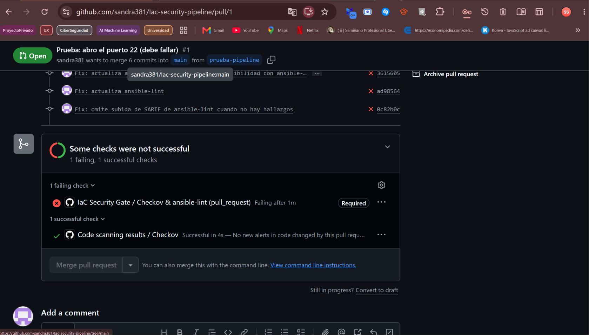
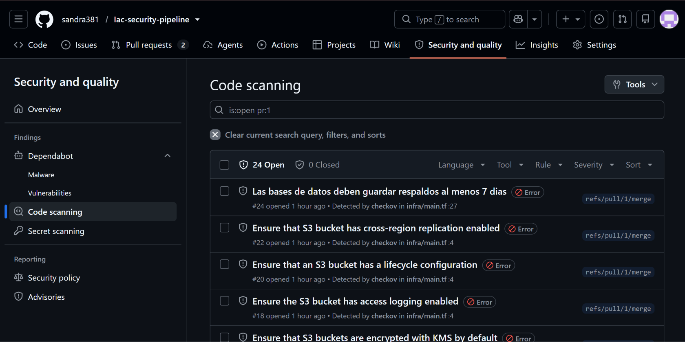
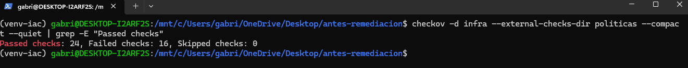
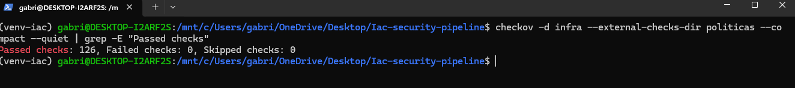
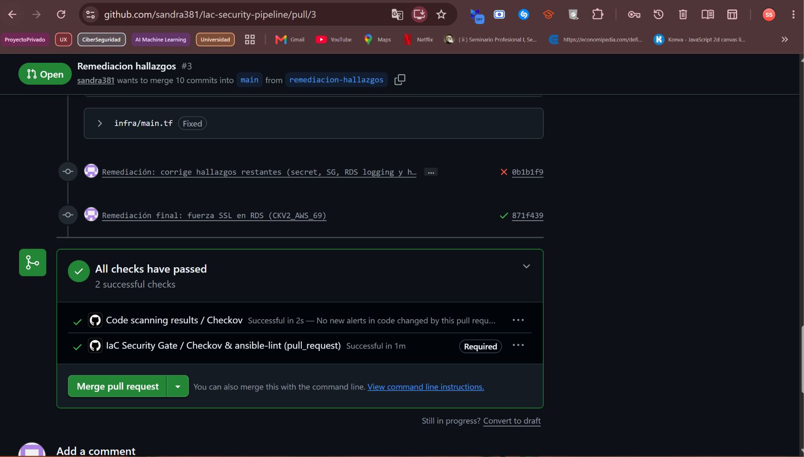
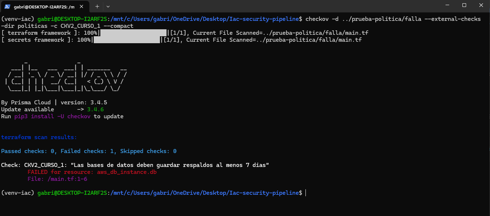
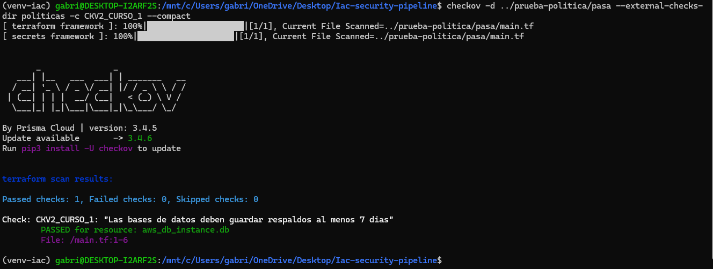

# Tarea: Análisis de seguridad IaC en el pipeline

**Curso:** Ciberseguridad  
**Universidad Galileo, FISICC**  
**Postgrado en Diseño y Desarrollo de Software**

## Integrantes

| Nombre | Carné | Usuario GitHub |
|---|---|---|
| Gabriela Lucía Navarro de León | 20000127 | Gabriela-Navarro |
| Sandra Daniela Soria Palma | 20002619 | sandra381 |

**Repositorio:** https://github.com/sandra381/Iac-security-pipeline


## 1. Línea base

Antes de crear el pipeline, se realizó un análisis local sobre la versión insegura del proyecto (commit `31e45b09`, "Versión insegura de práctica"). El análisis se hizo sobre los archivos de demo indicados en la guía de la tarea, copiados en `infra/`, `docker/` y `ansible/`. Estos archivos contienen configuraciones inseguras a propósito para que las herramientas puedan detectarlas.

Para esto se utilizaron Checkov 3.4.5 y ansible-lint 25.6.1.

```bash
checkov -d . --compact
ansible-lint --profile production ansible/
```

### Conteo de fallas por tipo de archivo

| Tipo de archivo | Herramienta | Pasaron | Fallaron |
|---|---|---|---|
| Terraform (`infra/main.tf`) | Checkov | 15 | 24 |
| Dockerfile (`docker/Dockerfile`) | Checkov | 25 | 5 |
| Secretos | Checkov | 0 | 1 |
| Ansible (`ansible/site.yml`) | ansible-lint | No se pudo analizar (error de indentación) | 1 |
| **Total** | | | **31** |


En el caso de Ansible, se encontró el error `load-failure[yaml]`. Esto sucedió porque el archivo `site.yml` tenía problemas de indentación y ansible-lint no podía leerlo correctamente.

Al revisar el archivo manualmente, también se encontraron otras configuraciones inseguras, como conexiones que no verificaban los certificados de seguridad, el uso de `shell` para ejecutar instrucciones en el servidor y archivos con permisos `0777`, que permiten a cualquier usuario del sistema leerlos, modificarlos y ejecutarlos.


### Los 5 hallazgos más graves y sus riesgos

Como Checkov en su versión gratuita no muestra la severidad, ordenamos los hallazgos según lo que consideramos más peligroso. Primero colocamos los recursos expuestos directamente a internet, luego las credenciales que podrían quedar expuestas y por último los datos que no cuentan con protección.

1. **CKV_AWS_24 – Acceso SSH abierto:** El servidor permite conexiones SSH desde cualquier dirección IP, por lo que cualquier persona en internet podría intentar acceder sin autorización.

2. **CKV_AWS_17 – Base de datos pública:** La base de datos está configurada para ser accesible desde internet, lo que aumenta el riesgo de ataques y exposición de información.

3. **CKV_SECRET_6 – Contraseña en el código:** Se encontró una contraseña escrita directamente en el código. Esto representa un riesgo porque cualquier persona con acceso al repositorio podría verla y utilizarla.

4. **CKV_AWS_16 – Base de datos sin cifrado:** La base de datos no tiene habilitado el cifrado, por lo que, si alguien obtiene una copia de los datos sin cifrar, podría leer la información.

5. **CKV_AWS_53 al 56 – Bucket S3 sin bloqueo público:** El bucket no tiene configuradas todas las restricciones de acceso público, por lo que los archivos almacenados podrían quedar expuestos a personas no autorizadas.

## 2. Diseño del pipeline

El pipeline se encuentra en el archivo `.github/workflows/iac-security.yml` y se encarga de revisar automáticamente los archivos de infraestructura para encontrar posibles problemas de seguridad. Si encuentra algún problema, el pipeline falla y, con la protección de la rama activada, no permite agregar esos cambios a `main`.

### 2.1 ¿Qué se escanea?

Se revisan los archivos de Terraform, Ansible y Dockerfile para detectar configuraciones que puedan representar un riesgo de seguridad. Además, se buscan contraseñas escritas directamente en el código y se comprueba que se cumpla con una política de seguridad creada por el equipo.

| Qué se revisa | Carpeta | Herramienta |
|---|---|---|
| Terraform | `infra/` | Checkov |
| Ansible | `ansible/` | Checkov y ansible-lint |
| Dockerfile | `docker/` | Checkov |
| Contraseñas o secretos en el código | Carpetas analizadas | Checkov |
| Política propia del equipo (regla en `politicas/`) | Se aplica sobre `infra/` | Checkov |

### 2.2 ¿En qué momento se ejecuta?

El pipeline se ejecuta automáticamente en dos casos:

- Cuando se crea o actualiza un **pull request** hacia la rama `main`.
- Cuando se realiza un **push** a la rama `main`.

```yaml
on:
  pull_request:
    branches: [ "main" ]
  push:
    branches: [ "main" ]
```

### 2.3 ¿Qué bloquea?

El pipeline cuenta con dos tipos de pasos, los que bloquean los cambios cuando encuentran problemas de seguridad y los que únicamente muestran los resultados.

**Pasos que bloquean (gates):** Se utilizan Checkov y ansible-lint para revisar los archivos. Si alguna de estas herramientas encuentra un problema de seguridad, el pipeline falla y no permite hacer el merge del pull request con la rama `main`, siempre que esta tenga activada la protección.

**Pasos que solo informan:** Se generan dos reportes SARIF, uno de Checkov y otro de ansible-lint, que se publican en la sección Security de GitHub. Estos reportes permiten revisar los problemas encontrados, incluso cuando los gates fallan. Ninguno de estos reportes bloquea los cambios.

### 2.4 Versiones fijas

```bash
pip install checkov==3.4.5 ansible-core==2.19.6 ansible-lint==25.6.1
```

Se utilizaron versiones fijas para que siempre se trabaje con las mismas versiones y evitar que una actualización cambie las reglas de seguridad o los resultados de las pruebas.

## 3. Evidencia del gate

Para comprobar que el pipeline bloquea los cambios inseguros, se creó un pull request donde se modificó intencionalmente una configuración de seguridad. En el commit `f8ca3e42` se cambió la configuración SSH para permitir conexiones desde cualquier dirección IP.

**Pull request:** [#1 Prueba: abro el puerto 22 (debe fallar)](https://github.com/sandra381/Iac-security-pipeline/pull/1)

### 3.1 El job falla

Al crear el pull request, el pipeline se ejecutó automáticamente y la revisión de seguridad de Checkov falló. Solo en los archivos de Terraform se encontraron 17 fallas, entre ellas `CKV_AWS_24`, que indica que el puerto 22 permite conexiones desde cualquier dirección IP, lo que representa un riesgo de seguridad.


### 3.2 La protección de rama impide el merge

La rama `main` tiene configurada una regla de protección que exige realizar los cambios mediante un pull request y que la revisión **Checkov & ansible-lint** termine correctamente antes de hacer el merge.

En el pull request, este check aparece marcado como **Required**, es decir, obligatorio. Como el check falló, GitHub desactivó el botón **Merge pull request** y no permite incorporar el cambio a `main`.



También se comprobó el funcionamiento de esta protección al intentar realizar un push directamente a `main` desde la computadora de una integrante del equipo. GitHub rechazó el cambio porque no cumplía con las reglas configuradas.

~~~
remote: error: GH013: Repository rule violations found for refs/heads/main.
remote: - Changes must be made through a pull request.
remote: - Required status check "Checkov & ansible-lint" is expected.
! [remote rejected] main -> main (push declined due to repository rule violations)
~~~

Con estas pruebas se comprobó que el pipeline detecta configuraciones inseguras y que la protección de la rama evita que los cambios se incorporen a `main` sin pasar las revisiones necesarias.

## 4. Evidencia SARIF

Los resultados de Checkov se guardan en el archivo `reportes/results_sarif.sarif`. SARIF es un formato que permite guardar los resultados de un análisis de seguridad para luego mostrarlos en herramientas como GitHub Code Scanning.

Estos resultados se publican automáticamente, incluso cuando la revisión de seguridad falla. Para verificarlo, podemos entrar a la sección **Security → Code scanning** de GitHub y revisar los problemas encontrados.

En la siguiente captura se muestran los 24 hallazgos encontrados por Checkov en el pull request #1. Cada uno muestra qué regla no se cumplió, en qué archivo se encontró y en qué línea está el problema.

También aparece la política de seguridad que creamos, lo que nos permite comprobar que se está revisando dentro del pipeline.



## 5. Remediación

Las correcciones se realizaron en la rama `remediacion-hallazgos`, mediante un pull request diferente al de la prueba anterior. Los commits se organizaron según el tipo de problema que se estaba corrigiendo.

**Pull request:** [#3 Remediacion hallazgos](https://github.com/sandra381/Iac-security-pipeline/pull/3)

Antes de realizar las correcciones, Checkov encontraba 16 fallas en el archivo `infra/main.tf`. Después de corregirlas, se ejecutó nuevamente el análisis y ya no se encontraron fallas. Además, se aprobaron 126 controles de seguridad.





### 5.1 Correcciones realizadas

En la siguiente tabla se muestran los problemas encontrados, los cambios realizados y los resultados obtenidos después de ejecutar nuevamente Checkov.

| ID | Recurso | Cambio realizado | Antes | Después |
|---|---|---|---|---|
| CKV_AWS_21 | `aws_s3_bucket.datos` | Se activó el versionado del bucket | FAILED | PASSED |
| CKV_AWS_145 | `aws_s3_bucket.datos` | Se configuró el cifrado con una llave KMS | FAILED | PASSED |
| CKV_AWS_18 | `aws_s3_bucket.datos` | Se activó el registro de accesos | FAILED | PASSED |
| CKV2_AWS_61 | `aws_s3_bucket.datos` | Se configuraron reglas para administrar los archivos del bucket | FAILED | PASSED |
| CKV2_AWS_5 | `aws_security_group.web` | Se asignó el grupo de seguridad a una instancia EC2 | FAILED | PASSED |
| CKV_AWS_157 | `aws_db_instance.db` | Se activó Multi-AZ | FAILED | PASSED |
| CKV_AWS_353 | `aws_db_instance.db` | Se activó Performance Insights | FAILED | PASSED |
| CKV_AWS_118 | `aws_db_instance.db` | Se activó el monitoreo mejorado | FAILED | PASSED |
| CKV_AWS_226 | `aws_db_instance.db` | Se activaron las actualizaciones menores automáticas | FAILED | PASSED |
| CKV_AWS_161 | `aws_db_instance.db` | Se activó la autenticación con IAM | FAILED | PASSED |
| CKV2_AWS_60 | `aws_db_instance.db` | Se configuró la copia de etiquetas a los respaldos | FAILED | PASSED |
| CKV_AWS_129 | `aws_db_instance.db` | Se configuró el envío de logs de PostgreSQL a CloudWatch | FAILED | PASSED |
| CKV2_CURSO_1 | `aws_db_instance.db` | Se configuró la retención de respaldos durante 7 días | FAILED | PASSED |
| CKV2_AWS_62 | `aws_s3_bucket.datos` | Se activaron las notificaciones de eventos | FAILED | PASSED |
| CKV2_AWS_30 | `aws_db_instance.db` | Se agregó una configuración para registrar las consultas | FAILED | PASSED |
| CKV_AWS_144 | `aws_s3_bucket.datos` | Se configuró la replicación a otra región | FAILED | PASSED |

Durante las correcciones se agregaron nuevos recursos, como buckets, llaves KMS y una instancia EC2. Al revisarlos, Checkov encontró otros problemas de seguridad que también se corrigieron en el momento. Entre ellos, la contraseña de la base de datos dejó de estar escrita en el código y ahora se genera automáticamente, y se configuró la base de datos para que solo acepte conexiones seguras con SSL.

Después de aplicar todas las correcciones, la revisión de Checkov y ansible-lint pasó sin problemas y los cambios se unieron a la rama `main`.



## 6. Excepción documentada

En el archivo `excepcion/main.tf` se dejó una sola excepción utilizando `checkov:skip`, para que Checkov no marque como error el control `CKV2_AWS_6`, que revisa si los buckets S3 tienen bloqueado el acceso público.

En este caso se hizo una excepción porque el bucket se utiliza para guardar los archivos de una página web que debe ser pública.

~~~hcl
resource "aws_s3_bucket" "sitio_publico" {
 # checkov:skip=CKV2_AWS_6: sitio web estático público, aprobado en RIESGO-042, vence 2027-01-31
 bucket = "galileo-sitio-web"
}
~~~

| Elemento | Detalle |
|---|---|
| Control omitido | `CKV2_AWS_6` |
| Recurso | `aws_s3_bucket.sitio_publico` |
| Justificación | El bucket guarda archivos de una página web pública |
| Referencia de aprobación | RIESGO-042 |
| Quién debería aprobarlo | Oficial de seguridad de la información y dueño del riesgo (responsable del sitio web) |
| Fecha de vencimiento | 31 de enero de 2027 |

### 6.1 ¿Por qué se acepta el riesgo?

Se acepta el riesgo porque el bucket necesita almacenar archivos de una página web pública, como imágenes y archivos HTML. Por eso, se permite esta excepción, siempre que no contenga información privada o sensible. Si llegara a almacenar este tipo de información, ya no sería adecuado mantener la excepción.

La excepción se aplicó únicamente a este bucket, ya que los demás deben mantener sus controles de seguridad para proteger la información que almacenan.

### 6.2 ¿Quién debería aprobarlo?

La excepción debería ser aprobada por el oficial de seguridad de la información y el dueño del riesgo, ya que ellos deben revisar que el riesgo sea aceptable y que el bucket no contenga información privada.

También se estableció una fecha de vencimiento para el 31 de enero de 2027. Al llegar esa fecha, se deberá revisar si todavía es necesario mantener la excepción, ya que las condiciones pueden cambiar y podría empezar a almacenarse información privada en ese bucket.

## 7. Política propia

Se creó una política de seguridad en el archivo `politicas/respaldos.yaml`, identificada como `CKV2_CURSO_1`. Esta política revisa que las bases de datos tengan configurados respaldos de al menos 7 días.

~~~yaml
metadata:
  id: "CKV2_CURSO_1"
  name: "Las bases de datos deben guardar respaldos al menos 7 dias"
  category: "BACKUP_AND_RECOVERY"
definition:
  cond_type: "attribute"
  resource_types:
    - "aws_db_instance"
  attribute: "backup_retention_period"
  operator: "greater_than_or_equal"
  value: 7
~~~

Se creó esta política porque, en la línea base, el control `CKV_AWS_133` de Checkov salió aprobado aunque la base de datos no tenía definido cuántos días se guardarían los respaldos. Por eso, se decidió agregar una regla que exija guardar los respaldos durante al menos 7 días, para poder recuperar la información en caso de algún problema.

### 7.1 Integración al pipeline

La política se agregó al pipeline utilizando `--external-checks-dir politicas`, para que Checkov también la revise al analizar los archivos del proyecto.

~~~bash
checkov -d infra -d ansible -f docker/Dockerfile \
  --external-checks-dir politicas \
  --compact --quiet
~~~

En el pull request #1, la política apareció entre los problemas encontrados en Code Scanning, como se muestra en la captura de la sección 4.

Después, en el pull request #3, se configuraron los respaldos durante 7 días y la política pasó de FAILED a PASSED, como se muestra en la tabla de la sección 5.

### 7.2 Caso que falla

Para comprobar que la política funcionara, se creó un archivo de prueba con una base de datos configurada para guardar respaldos durante solo 3 días.

~~~hcl
resource "aws_db_instance" "db" {
  identifier              = "demo-db"
  engine                  = "postgres"
  instance_class          = "db.t3.micro"
  backup_retention_period = 3
}
~~~

Al ejecutar Checkov, la política marcó FAILED porque los 3 días configurados no cumplían con el mínimo de 7 días.

Resultado: `Passed checks: 0, Failed checks: 1`



### 7.3 Caso que pasa

Después se modificó el mismo archivo, cambiando los días de respaldo de 3 a 7.

~~~hcl
backup_retention_period = 7
~~~

Al ejecutar nuevamente Checkov, la política marcó PASSED porque ahora sí cumplía con los 7 días establecidos.

Resultado: `Passed checks: 1, Failed checks: 0`



## 8. Conclusiones

Durante las pruebas se comprobó que el pipeline detectó y bloqueó los cambios inseguros del pull request #1. Luego, en el pull request #3, se corrigieron los problemas encontrados y esto permitió que el archivo `infra/main.tf` pasara las revisiones de seguridad sin fallas. Sin embargo, se identificaron algunos problemas que las herramientas no lograron detectar.

* En el Dockerfile había una contraseña escrita directamente en el código que Checkov no detectó. Para encontrar este tipo de problemas se podría utilizar Gitleaks, que también permite revisar el historial de commits.
* El archivo `site.yml` daba errores de indentación, por lo que ansible-lint no pudo analizarlo correctamente y no logró detectar otros problemas, como los certificados sin verificar y los permisos `0777`. Para evitar esto, se podría agregar al pipeline el paso `ansible-playbook --syntax-check`, que revisa primero que el archivo esté escrito correctamente.
* El control de respaldos de Checkov aprobó la base de datos aunque no tenía definidos los días de respaldo. Por eso, creamos la política `CKV2_CURSO_1`, que exige guardar los respaldos al menos 7 días. Esto demuestra que también es necesario crear reglas propias para detectar problemas que Checkov no identifica.

Con esto comprobamos que Checkov y ansible-lint ayudan a detectar problemas de seguridad, pero no pueden identificar todos los errores. Por eso, es importante complementar estas herramientas con revisiones manuales y otras herramientas de seguridad.

## 9. Uso de IA

Se utilizó Claude (Anthropic) como apoyo para:

* Entender mejor el tema de seguridad en IaC y cómo se aplicaba en el laboratorio.
* Entender la guía del laboratorio y los archivos del proyecto.
* Resolver problemas durante la configuración del pipeline.
* Apoyar en el código.
* Analizar los resultados que mostraba la terminal e identificar algunos problemas.
* Mejorar la redacción del informe.

Los resultados de Checkov y ansible-lint que aparecen en el informe se ejecutaron y verificaron localmente, y las capturas corresponden a esas ejecuciones.